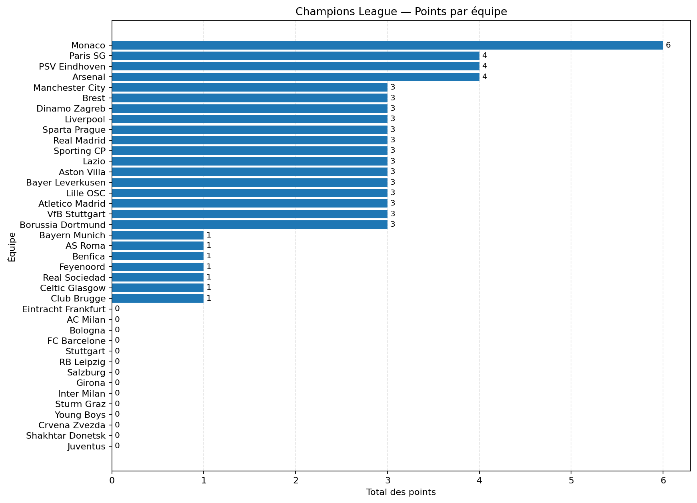
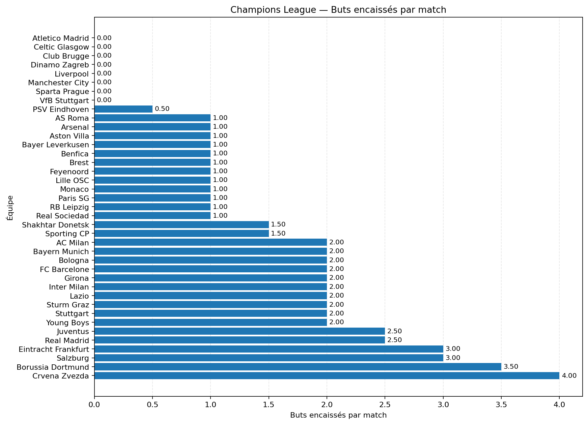

# 🏆 Champions League Analytics — Databricks & PySpark

[](https://www.databricks.com/)
[](https://spark.apache.org/)
[](https://www.python.org/)
[](https://pandas.pydata.org/)
[](https://matplotlib.org/)
[](https://github.com/)

## 📝 Présentation du projet

**Champions League Analytics** est un projet pédagogique de Data Analytics développé avec **Databricks, Apache Spark et PySpark**. Il vise à analyser les performances d'équipes de football à partir d'un jeu de données simulé de 24 matchs de la Ligue des champions de l'UEFA.

L'objectif est de mettre en pratique les principales étapes d'un projet analytique : préparation des données, calcul des indicateurs métier, agrégation des résultats, classement des équipes et création de visualisations statiques adaptées à une publication sur GitHub.

Le projet illustre une démarche de transformation des données brutes en informations exploitables pour l'analyse et la prise de décision.

> **Périmètre :** les données sont simulées à des fins d'apprentissage. Les résultats ne constituent pas un classement officiel de l'UEFA.

## 🎯 Objectifs analytiques

- Préparer et structurer les données de matchs avec PySpark.
- Calculer les points attribués aux équipes à domicile et à l'extérieur.
- Consolider les performances individuelles des équipes.
- Construire un classement selon les points, la différence de buts et les buts marqués.
- Analyser l'efficacité offensive et la performance défensive.
- Attribuer un statut pédagogique selon la position au classement.
- Générer des graphiques statiques au format PNG pour GitHub.
- Préparer une base analytique réutilisable dans un environnement de Business Intelligence.

## 🏗️ Architecture du projet

Le notebook est organisé en étapes successives de préparation, transformation, agrégation et restitution.

```text
┌─────────────────────────────────────────────┐
│             SOURCE DE DONNÉES               │
│         24 matchs simulés en Python          │
└──────────────────────┬──────────────────────┘
                       │
                       ▼
┌─────────────────────────────────────────────┐
│           PRÉPARATION — PySpark             │
│   Schéma explicite et calcul des points     │
└──────────────────────┬──────────────────────┘
                       │
                       ▼
┌─────────────────────────────────────────────┐
│          TRANSFORMATION — PySpark           │
│  Fusion domicile / extérieur et agrégation  │
└──────────────────────┬──────────────────────┘
                       │
                       ▼
┌─────────────────────────────────────────────┐
│          ANALYSE — INDICATEURS              │
│ Classement, différence de buts et défense   │
└──────────────────────┬──────────────────────┘
                       │
                       ▼
┌─────────────────────────────────────────────┐
│         VISUALISATION — Matplotlib           │
│       Export de graphiques statiques PNG    │
└──────────────────────┬──────────────────────┘
                       │
                       ▼
┌─────────────────────────────────────────────┐
│                RESTITUTION                  │
│         Notebook Databricks et GitHub       │
└─────────────────────────────────────────────┘
```

Cette organisation reprend les principes de séparation des responsabilités utilisés dans les projets Data. Une évolution vers une architecture Medallion Bronze / Silver / Gold est envisageable lorsque le projet intégrera des données persistées et des traitements distincts par couche.

## 🛠️ Technologies utilisées

| Technologie | Utilisation |
|---|---|
| Databricks | Environnement de développement et d'exécution |
| Apache Spark / PySpark | Transformation et agrégation distribuées |
| Python | Préparation des données et logique analytique |
| Pandas | Conversion des résultats agrégés pour les graphiques |
| Matplotlib | Création et export des visualisations PNG |
| Git / GitHub | Versionnement, documentation et partage du projet |

## 📊 Indicateurs analytiques

Le classement agrégé expose les principaux indicateurs suivants :

| Indicateur | Description |
|---|---|
| `matches_played` | Nombre de matchs disputés par équipe dans le jeu simulé |
| `total_points` | Total des points obtenus : 3 pour une victoire, 1 pour un nul et 0 pour une défaite |
| `total_scored` | Nombre total de buts marqués |
| `total_conceded` | Nombre total de buts encaissés |
| `goal_difference` | Différence entre les buts marqués et les buts encaissés |
| `goals_conceded_per_match` | Moyenne de buts encaissés par match |
| `rank` | Position calculée dans le classement pédagogique |
| `uefa_status` | Catégorie pédagogique déterminée à partir du rang |

### 🏅 Catégories du classement

- 🟢 **Qualifié direct :** rangs 1 à 8.
- 🟡 **Barragiste :** rangs 9 à 24.
- 🔴 **Éliminé :** rangs 25 et suivants.

Ces catégories reprennent les seuils du format de la phase de ligue de l'UEFA Champions League. Toutefois, le classement du projet utilise des critères de départage simplifiés et des données incomplètes : il ne doit pas être interprété comme un classement officiel.

## 📈 Visualisations

Les graphiques sont produits avec Matplotlib et enregistrés en images PNG afin de permettre leur consultation directe sur GitHub.

### 1. Classement par points

Cette visualisation compare le total des points obtenus par chaque équipe et facilite l'identification des meilleures performances dans le jeu simulé.



### 2. Analyse défensive

Cette visualisation compare le nombre moyen de buts encaissés par match. Une valeur plus faible correspond à une meilleure performance défensive sur les matchs disponibles.



> **Note :** les images doivent être générées par le notebook et enregistrées dans le dossier `images/` du dépôt. Si elles ne sont pas encore publiées, les aperçus ne s'afficheront pas sur GitHub.

## 📁 Structure du dépôt

```text
champions-league-analytics/
│
├── README.md
├── notebooks/
│   └── champions_league_analytics.ipynb
│
├── images/
│   ├── champions_league_ranking.png
│   └── champions_league_defense.png
│
└── .gitignore
```

- `README.md` : présentation, architecture et résultats du projet.
- `notebooks/` : notebook Databricks exporté au format Jupyter `.ipynb`.
- `images/` : graphiques statiques utilisés dans la documentation.
- `.gitignore` : exclusion des fichiers temporaires ou locaux non nécessaires au dépôt.

## 🚀 Installation et exécution

### Prérequis

- Un espace de travail Databricks avec un environnement Python et PySpark compatible.
- Un notebook Databricks ou Jupyter prenant en charge PySpark.
- Matplotlib pour générer les graphiques.
- Git et un compte GitHub pour publier le projet.

### Étapes d'exécution

1. Cloner le dépôt GitHub ou télécharger le notebook.
2. Importer le notebook dans Databricks.
3. Attacher le notebook à un environnement de calcul compatible.
4. Exécuter les cellules dans l'ordre, ou utiliser la cellule autonome prévue pour reconstruire les données et calculer le classement.
5. Vérifier les résultats des agrégations et des indicateurs.
6. Générer les graphiques PNG.
7. Récupérer les images dans le dépôt GitHub, puis les versionner avec le notebook et le README.

### Dépendances Python

Si Matplotlib n'est pas disponible dans l'environnement :

```python
%pip install matplotlib
```

Aucune installation de Seaborn n'est nécessaire pour la version actuelle du projet.

## 🔍 Contrôles qualité et pistes d'amélioration

Les prochaines évolutions pourront inclure :

- Validation des identifiants de matchs et détection des doublons.
- Contrôle des scores négatifs et des valeurs manquantes.
- Vérification de la cohérence des équipes et des résultats.
- Ajout du taux de victoire et de la moyenne de buts marqués.
- Comparaison des performances à domicile et à l'extérieur.
- Tests automatisés des règles de calcul des points.
- Persistance des résultats dans des tables Delta Lake.
- Mise en place progressive des couches Bronze, Silver et Gold.
- Connexion à Power BI ou Tableau pour une restitution décisionnelle.

## 💼 Valeur métier

Ce projet démontre la mise en œuvre d'un flux analytique allant de la préparation des données à leur restitution visuelle.

Il permet de valoriser des compétences en :

- **Data Analytics :** construction d'indicateurs et interprétation des performances.
- **Data Engineering :** transformation et agrégation de données avec PySpark.
- **Data Quality :** validation de la cohérence des résultats
